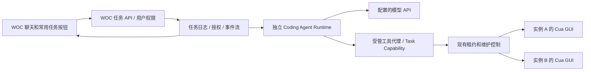

# WOC 完整桌面与 AI 控制台方案

日期：2026-10-28。源码基线：`8530306`。状态：**调研与设计，等待用户确认后实施**。本次仅阅读源码、官方资料及 P5 容器组件信息，未安装软件、改部署、启动新 Agent 或操作微信内容。

## 1. 建议结论

WOC 可以继续作为统一入口，保留现有应用、安装、备份和多实例管理。新增两项独立需求，分别实现、验收和提交：

1. **完整电脑桌面**：沿用同一个容器、同一个 X 会话、同一个 KasmVNC 和 Cua 控制租约，补齐桌面启动器、任务栏、文件管理器，以及网页全屏和鼠标捕获入口。
2. **AI 控制台**：WOC 页面增加聊天和任务栏；后端使用独立 coding-agent runtime，通过受管工具代理控制实例。先选一个支持 API key 和自定义 API endpoint 的 runtime，实现适配接口，避免把产品绑定到某一家模型。

两项均不依赖微信数据库。数据库试验、UI 监控、自动回复的授权与一致性规则属于共同的任务控制层；不能把这些规则只写在提示词或 skill 中。这里提出接口，监控状态机另见对应设计。

## 2. 当前桌面到底是什么

### 已核实的源码证据

| 事实 | 证据 |
| --- | --- |
| WOC 实例基于 Debian Bookworm 的 LinuxServer KasmVNC 基础镜像；当前 Cua 派生镜像固定在已验收的 WOC 1.5.2 digest 上 | [docker/Dockerfile](../../docker/Dockerfile)、[docker/cua/Dockerfile](../../docker/cua/Dockerfile) |
| 浏览器展示的是完整 X 桌面的图像流；没有把微信控件翻译成 HTML 页面 | [Desktop.tsx](../../panel/web/src/pages/Desktop.tsx) 的 `desktopUrl()` 创建 `/desktop/:id/vnc/index.html` iframe，服务器反代对应实例 KasmVNC |
| 当前页面已经允许点击、键盘、中文输入、剪贴板及文件传入；只是界面围绕“主应用”组织 | [Desktop.tsx](../../panel/web/src/pages/Desktop.tsx) 的 IME、paste bridge、VNC iframe 与控制工具栏 |
| 当前窗口管理器是 Openbox，原版 WOC 没任务栏；因此原版脚本会每 2 秒把最小化窗口激活回来 | [autostart](../../docker/autostart) 的 `WOC_RESTORE_MINIMIZED` 分支 |
| Cua 受管实例已经关闭这个“恢复最小化”看守，允许多个窗口并存 | [registry.ts](../../panel/server/src/cua/registry.ts) 下发 `WOC_RESTORE_MINIMIZED=0` |
| 当前 P4 镜像在 Agent/维护持有期间暂停主应用自动重拉；应用本身仍在运行 | [lifecycle/Dockerfile](../../docker/lifecycle/Dockerfile)、[control/runtime.ts](../../panel/server/src/control/runtime.ts) |
| 人工和 Agent 共用服务端租约；Agent 入口目前是可信服务级别凭证，可申请该面板全部受管实例，尚非按任务/用户授权 | [cua-agent/README.md](../../integrations/cua-agent/README.md)、[control/routes.ts](../../panel/server/src/control/routes.ts) |

### 运行实例只读核查

2026-10-28 对 P5 `woc-wx-77bafd5161` 执行 `command -v`、`dpkg-query`、读取启动脚本与单个环境变量：

- `/defaults/woc-startwm.original` 最终运行 `/usr/bin/openbox-session`。
- `/usr/bin/openbox` 可用，已安装版本 `3.6.1-10`；`/usr/bin/xterm` 可用，版本 `379-1`。
- `xfce4-session`、`tint2`、`lxpanel`、`pcmanfm` 的 `command -v` 均未找到。没有据此推断其他所有桌面软件都不存在。
- `WOC_RESTORE_MINIMIZED=0`。

**因此，仅加按钮可以提供“放大的现有桌面”，还不足以提供用户期望的有任务栏、应用菜单和文件管理器的完整电脑体验。** 不需要重新搭建另一套 VNC，也不建议在同一容器内再启动一个 X server：那会分离人工、Agent 和微信所在的会话。

LinuxServer 对基础镜像的官方定位也是浏览器访问 Linux 桌面。KasmVNC 官方文档已有全屏相关功能、Pointer Lock、相对鼠标模式和特殊按键面板，但当前打包版本、iframe 和浏览器组合仍须实测，不能将最新文档能力当作当前环境已验收能力。[基础镜像源码](https://github.com/linuxserver/docker-baseimage-kasmvnc)、[KasmVNC 客户端文档](https://www.kasmweb.com/kasmvnc/docs/master/clientside.html)

## 3. 桌面增强实施切片

### D1：沿用 Openbox 补全桌面，优先建议

新派生镜像安装轻量任务栏/启动器和文件管理器，建议候选 `tint2 + pcmanfm`，终端沿用已存在的 `xterm`。构建时锁定实际可用包版本，在**全新空白测试实例**验证，之后用户再决定是否迁移已有登录实例。

- 保留 Openbox、原有 DBus 会话、Cua AT-SPI 接入、微信安装和数据卷；不替换为另一套启动会话。
- 桌面 profile 设为显式开关，新增组件只在开启 profile 时启动；旧应用入口默认外观可保持。
- 任务栏和菜单提供主应用、浏览器、文件管理器、终端、窗口切换。快捷入口是启动或聚焦窗口，不能误称为每个应用独立会话。
- 定义应用维持策略：保留微信退出后重拉；完整桌面模式允许正常最小化和切换。若需要主动“暂停主应用”，应做受管显式操作，避免窗口关闭与看守不断重启互相打架。
- 外加软件在一个容器内共享用户、文件和会话，适用于可信个人工作环境；不能承诺像多台虚拟机一样隔离。容器 A 的应用退出、窗口切换也不应影响容器 B。

备选 D2 是 XFCE，但这要改会话启动、DBus/AT-SPI、窗口守护与资源预算，回归面更大。仅当 Openbox 方案不能满足桌面体验，再单独评估；本轮不建议直接换基础镜像。

### D3：网页入口和输入规则

现有 `/i/:id` 增加“电脑桌面”视图或独立路由，**复用同一桌面组件和控制状态**。应用视图与桌面视图是布局切换，不是第二台机器。应在同页切换，避免不必要地重建 iframe；原代码明确记录了旧 WebSocket 未关闭造成 KasmVNC 半开连接的问题。

- 工具栏：返回应用、窗口列表、显示桌面、全屏、捕获鼠标、特殊按键、申请/交回控制、当前控制者。
- 全屏与鼠标锁定由明确的用户点击触发；Esc 可释放鼠标。失焦、断线、租约失效均清理按键/鼠标状态并退出捕获。
- “鼠标捕获”与游戏相对位移模式分开；普通桌面先用绝对坐标，不能因为要捕获鼠标就默认启用相对模式。
- 当前 iframe 未显式写 `allowFullScreen`。实施时核对 Fullscreen API/Permissions Policy、Pointer Lock 与 iframe 属性，不应仅添加一个无效按钮；浏览器不支持时给出可理解的提示。
- **只有当前持有者可以改变远端分辨率**。观察页面采用客户端缩放；现在 URL 的 `resize=remote` 必须纳入验证，否则旁观页/AI侧栏出现就可能改变 Agent 坐标。分辨率或窗口布局变化使旧截图/旧坐标失效，重新观察后再操作。
- 同一用户打开两个页面也不是两个控制者可同时输入：继续绑定 `clientId + epoch`；新页只读，显式接管后旧页失效。

### D4：验收与回滚

新实例验证：桌面和微信来回切换、任务栏恢复最小化、浏览器/文件管理器/终端、中文、拖动窗口、全屏/Esc、捕获鼠标/失焦、两页大小不同、人工与 Agent 接管、断线重连、重启后组件不重复启动。应用安装/备份/还原/自动注册继续通过已有门禁。

桌面 profile 关闭后回到已有应用视图；镜像升级走 P4 备份/维护/回滚流程。D 系列提交只含桌面变更，不夹带 AI runtime、数据库或自动回复。

## 4. AI runtime 候选与建议

### 公开能力已核实，具体版本尚未试接

| 候选 | 证据及适配程度 | 本项目建议 |
| --- | --- | --- |
| OpenCode headless server + TS SDK | 官方提供 headless HTTP/OpenAPI、会话、取消、权限应答与 SSE；可通过 API key、baseURL 和模型配置连接 API；支持 SKILL.md | **建议首个 PoC 候选**：独立服务、API only、多模型适配较直接。先验证模型能正确处理工具/图片，再锁版本 |
| Paseo daemon + `@getpaseo/client` | 官方 SDK 提供 coding agent 会话、状态、事件和权限；Paseo 调用底层 agent CLI，不替代底层 provider 的认证 | 保留适配器选项；若希望共享 Paseo 的项目/Agent/任务视图可选。不能把当前个人 Paseo daemon 直接开放给 WOC 用户 |
| 自建模型 API 工具循环 | 能精确控制执行策略，但需自己实现会话、工具循环、上下文压缩、恢复、权限和技能加载 | 不作为首版默认，先复用成熟 coding runtime；控制规则仍由自己的 broker 执行 |

OpenCode 的协议适配需区别 `/v1/chat/completions` 和 `/v1/responses`，不是所有“兼容 API”都行为一致。配置 schema 应明确 protocol、baseURL、model、secretRef、能力（图像、工具、流式）与调用预算。[Providers](https://opencode.ai/docs/providers/)、[SDK](https://opencode.ai/docs/sdk/)、[Server](https://opencode.ai/docs/server/)

OpenCode 现成支持 skill 加载和 allow/ask/deny 权限，但这只是 runtime 层能力，不能代替 WOC 服务端的实例范围和控制租约。[Skills](https://opencode.ai/docs/skills/)、[Permissions](https://opencode.ai/docs/permissions/)

本机 `paseo --version` 为 `0.13.2`。没有为调研创建/修改 Paseo agent、provider 或配置，也未假设本机与官方最新 SDK 必然兼容。Paseo SDK 路径应先做版本与事件映射测试，另外为 WOC 建隔离的 runtime/工作目录；模型密钥仍由实际 agent provider 管理。[Paseo SDK](https://github.com/getpaseo/paseo/blob/main/public-docs/sdk/reference.md)、[会话](https://github.com/getpaseo/paseo/blob/main/public-docs/sdk/agents.md)、[事件](https://github.com/getpaseo/paseo/blob/main/public-docs/sdk/events.md)、[认证边界](https://github.com/getpaseo/paseo/blob/main/public-docs/security.md)

## 5. AI 控制台架构

建议新增 `agent-runtime` 服务，部署到 llm-server；独立工作目录、资源限制和配置卷。先通过内网连接 WOC broker，不要求每个微信容器再安装一个 coding agent。runtime 可在自己的工作目录写脚本、执行有限测试，实际虚拟电脑操作必须经 broker。

### 必须补的权限边界

1. WOC 登录身份与实例访问权限决定可选目标。聊天请求记录目标 `instanceId` 集合，不能由模型随意扩大。用户只授权 A 时，模型请求 B 应被服务端拒绝。
2. broker 持有现有服务级 token，runtime 不获得这个 token、Docker socket、宿主 SSH、微信数据卷或 Cua 原始管理端口。给 runtime 的任务能力绑定用户、实例范围、工具范围、期限和 taskId。
3. 桌面观察、导航、修改、发送、安装/重启/恢复分级。聊天中的“看一下”不扩大成任意发送或运维权限。数据库试验另用批准记录与严格尝试计数，AI 对话本身不能隐式授权重试。
4. GUI 键鼠本身足以发送消息，**不能宣称只靠禁用 `send_message` 工具就杜绝发送**。受限任务尽量只开放高层 workflow；需要任意 GUI 的任务必须按整个操作范围授权，涉及外部副作用前明确检查。skill 的约定是配合规则，不是安全沙箱。
5. 屏幕、聊天文本、文件和网页内容作为不可信数据，不允许其中的“指令”改变目标或扩权；授权对象来自 WOC 会话，不能来自被观察的微信消息。

### 任务生命周期与人机协作

建议业务任务状态：`queued → running → waiting_human / waiting_control / reconciling → completed`，终态另有 `failed / cancelled / uncertain`。业务任务跨越多个短租约；P4 的一次租约 taskId 作为子记录，不强行等同于整个聊天任务。

- 人工拿到控制权，立即停止排入新输入；正在执行的动作遵循已有 drain/uncertain 机制。通知 runtime 暂停，不能一边“等待”一边后台点击。
- 交回后重新申请租约、取新截图/树、验证聊天与草稿，再决定继续。旧坐标和缓存状态不得自动重放；自动回复还需对齐监控消息游标。
- 不在长时间模型推理期间无意义占着所有实例。首版跨实例任务按顺序逐台申请、释放；有需要再设计多租约排序，避免 A→B 和 B→A 死锁。
- 取消任务会停止模型推理和未执行动作、释放控制。已送出的消息不能通过“取消”撤回；结果未知时记 `uncertain`，先核对，不能自动补发。
- runtime 重启、面板重启、实例 generation 改变都触发恢复检查。发送与安装等副作用禁止自动重放。

### 流式 UI、密钥和审计

- 前端展示用户输入、简短计划、正在执行的工具、目标实例、需要确认的具体动作、结果与证据，不展示模型隐藏推理。
- WOC 为每个业务任务存储有序事件，提供 SSE 或等价推送；页面重连以事件序号补读。不能仅转发 runtime 瞬时 token 流，否则断线后无法恢复审批卡片和任务状态。
- 模型 API 密钥只进入后端 secret store，网页显示掩码；不放 localStorage、prompt、命令行或日志。模型 endpoint 配置仅限管理员，允许明确配置的内网 API，不能让普通任务把请求目标任意改为宿主内部服务。
- 模型调用预算、超时和并发上限与每次业务授权独立。截图可能包含微信内容，界面应明确显示使用哪家 API；可配置先裁剪/脱敏再上传，不能把开启聊天面板等同于授权上传所有实例画面。
- 审计关联 userId、businessTaskId、runtimeSessionId、instanceId、generation、lease taskId、actionId、授权记录与结果。文本/截图证据单独权限与保留期，普通动作日志尽量不保存完整聊天内容或密钥。

## 6. 日常脚本、workflow、skill 与按钮的统一入口

不是给同一个功能维护三套实现。建议层次：

| 层 | 放什么 | 不承担什么 |
| --- | --- | --- |
| 受管基础工具 | 获取实例/状态、截图/树、租约、单次输入、窗口操作、动作结果解析 | 猜联系人、决定是否允许发送 |
| 稳定脚本 | 参数校验、目标核对、持久化游标/授权/幂等记录、收尾释放、超时与不确定性处理 | 固定坐标盲点、通用重试发送 |
| AI workflow | 找到正确会话、理解弹窗、比对 UI 证据、判断需人工介入 | 更改授权、绕过互斥、把模型猜测当消息 ID |
| Skill | 任务使用说明、工具契约、脚本入口、执行/复核顺序、恢复规则 | 保存 token，单独实现权限边界 |
| 面板按钮/聊天 | 表单收集参数、预览授权范围、创建同一个业务任务 | 自己另写一套 UI 点击逻辑 |

先设计 `inspect_instance`、`open_chat`、`read_visible_messages`、`draft_message`、`cancel_draft`、`send_message` 等接口与 evidence/coverage 字段；UI 模式返回的是“当前可见/已扫描范围”，不能承诺完整历史。未来数据库 adapter 可以补全读取能力，但发送、审批和业务任务接口应保持稳定；数据库权限不能随读取接口的统一而被隐藏。

## 7. 建议实施顺序与确认点

| 阶段 | 产物 | 通过条件 |
| --- | --- | --- |
| 现有 P5 收尾 | 草稿取消、接收、接管、过夜状态 | 按原计划独立完成；不等待本方案 |
| 桌面需求 D | 新 profile 镜像 + 完整桌面入口，独立提交 | D4 门禁通过，旧实例未变；用户决定升级 |
| AI-0 | runtime 兼容 PoC，先用模拟实例/工具 | API key 接入、流式/取消/权限、重连和图片工具契约通过 |
| AI-1 | WOC 聊天、任务、授权卡片、只读工具 | 目标范围拒绝、事件补读、密钥不泄露 |
| AI-2 | 受管 GUI workflow + skills + 常用按钮 | 人工接管中断、恢复对齐、未知结果不重发 |
| AI-3 | 多实例任务与监控/回复集成 | 单实例互斥、跨实例隔离、监控状态机与授权一致 |

需要用户确认的是：完整桌面优先采用轻量 Openbox 方案；AI runtime 首先试 OpenCode，还是优先接独立 Paseo；首批模型 API 的协议/模型与画面发送范围；首批常用任务和发送权限策略。**本文件不表示这些新功能已经获准部署。**

建议保持两个需求分开：桌面增强无需等待 AI；AI 控制台也可直接控制现有桌面，不以完整桌面壳为硬依赖。源码和官方资料可以支持以上可行性判断，最终兼容性必须在新测试实例和限定授权场景验证。
