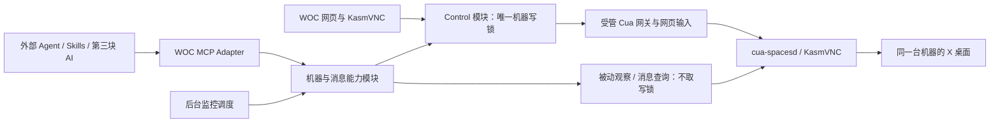

# 第二块 v2：消息读取、监控和人机协作

2026-10-29，源码基线 `7cb6721`。**讨论稿，尚未批准实现。** 本轮只检查代码与官方协议资料、修改方案，没有启用真实消息监听、数据库读取或自动回复。

本项目三块固定为：① 新增完整桌面模式；② 消息读取、监控和人机协作；③ WOC 网页中的 AI 对话和日常操作。第一块已统一到 36083，功能交付、过夜观察另行收尾。本文是第二块，不将第三块的 UI/runtime 当作前置依赖。

## 1. 本轮调整

- 每台机器只有一个受管写锁；所有获准观察者可并发读。不引入单独“监控锁”“消息锁”或 MCP 自己的第二把锁。
- 保留 WOC 网页交互及 KasmVNC 传输，网页与新增 MCP 共享现有 ControlLeases。保留原版网页体验不等于让网页输入绕过锁。
- 新增机器控制、消息读取、监控、日常任务对外统一由 WOC MCP 提供；内部后台任务直接调用同一实现，不需要绕一次 MCP 网络请求。
- Cua 继续承担远端截图、辅助功能树、键鼠和窗口操作；MCP 是入口，既不替换 Cua，也不重新实现远程桌面。
- Cua Spaces 原生 App 直连按用户要求保留为不参与互斥的兼容入口。本设计的单写者保证只适用于受管入口；Agent skill 不应使用该直连例外来绕过锁。
- 删除此前 OFF/BASELINE/HUMAN/RECONCILING/EXECUTING 等大型监控状态机。锁、监控开关、消息覆盖进度分别记录。
- 数据库探测移到 [独立研究](Cua-数据库读取独立研究.md)，不属于第二块。将来只接已经获准、验证过的读取能力，不预先实现空壳 DB adapter。

## 2. 当前 Cua 原理与已实现控制

### 两条画面/操作链路

WOC 网页：浏览器 → WOC 反向代理 → KasmVNC → 容器的 X 桌面。Agent：skill/CLI → 受管 Cua 网关 → 容器内 cua-spacesd → Cua Driver/辅助功能与系统输入 → 同一个 X 桌面。两路共享的是远端桌面，不要求 Agent 从网页里识别 canvas。Agent 操作时其他人可看同一个桌面的变化。

Skill 是给 Agent 的用法说明，不是传输协议，也不自动提供锁。Cua CLI、SDK、官方 MCP 是不同客户端入口；我们目前测试的是 CLI 0.7.0、spacesd 0.6.0，受管链路实际使用 HTTP/1 gRPC-Web。官方当前文档也描述 spacesd 的 gRPC/gRPC-Web 与 `/mcp`，但不能据此宣称现有锁网关支持全部官方 MCP 工具。[Cua 协议](https://cua.ai/docs/cua-sdk/reference/protocol)、[Spaces 入口](https://cua.ai/docs/spaces)

### 当前权限

| 入口 | 当前行为 |
| --- | --- |
| WOC 网页 | 登录与实例访问校验；默认只读；申请/交回控制；人工可接管 Agent；输入条和 VNC 写权限受同一租约约束 |
| 受管 Agent CLI | 使用可信服务凭证申请短期写租约，再用官方 Cua CLI 调受管网关；30 秒 TTL，执行中每 5 秒续租；过期不能写 |
| Master 自动登记 | 登记观察凭证，允许截图/读树等白名单读取，不能直接点击/打字 |
| 网关 | 只放行明确分类的 GUI RPC；写操作核对当前租约；未知 RPC、原始 `/mcp`、shell/隧道等默认不开放 |
| Cua Spaces 原生 App | P5 独立直连通道，绕过受管网关，按本轮要求继续保留；与受管操作同时使用仍可能冲突 |

现有持有者由 `human/agent + actorId` 表示；epoch 是某次控制权的版本，generation 是实例重建版本。交接先失效旧 epoch，再撤销网页写权限、断开旧可写连接、排空在途动作，最后授予新持有者。RPC 结果未知会阻止继续输入；租约不能撤销已经发出的消息。

源码：[leases](../../panel/server/src/control/leases.ts)、[runtime](../../panel/server/src/control/runtime.ts)、[读写白名单](../../panel/server/src/control/protocol.ts)、[gateway](../../panel/server/src/control/gateway.ts)、[受管 CLI](../../integrations/cua-agent/README.md)。现有服务凭证可申请全体受管实例，不是已经完成的按 Agent/任务授权系统。

## 3. 简化后的控制模型

一个机器级 Control 模块负责唯一写锁。对外只暴露三个状态：

| 状态 | 含义 |
| --- | --- |
| `free` | 可以申请写控制 |
| `held` | 某个人工页面或 Agent 任务持有写控制 |
| `blocked` | 正在交接、维护或等待故障恢复；`reason` 解释原因 |

`human/agent` 是持有者属性，不再扩展出不同业务状态。底层现有 handover/faulted/maintenance 的处理可保留，映射为 blocked；简化外部 Interface，不为改名而重写已验收的控制引擎。

必要记录：`machineId, state, owner, leaseRef, epoch, generation, expiresAt, reason`。owner 由认证身份与 task/session 绑定，不信任模型随意提供的 actorId。每个 Agent 任务独立身份，不能用同一服务身份让多个任务都以为自己是持有者。

规则：

1. 读不申请写锁，读不阻塞写；仍检查读权限、范围与资源限额。可以观察另一个 Agent 操作；不是无权限公开桌面。
2. 写锁覆盖一段连贯的操作，例如“打开聊天 → 核对对象 → 输入 → 发送 → 核验”，不能每个点击都释放后重新抢锁。同一持有者的并发写也串行；首版沿用当前“存在在途写则返回忙”，不引入隐式队列。
3. Agent 遇到 held 返回 `CONTROL_BUSY`，不抢其他 Agent 或人工。后台扫描短时尝试，忙则推迟。人工通过网页明确接管；不能在旧动作尚未排空时声称已接管成功。
4. 锁采用租约避免客户端失联永久占用。执行器负责心跳与释放，外部调用提供 renew；设置最长会话与空闲上限，不能因 MCP 连接还活着就永远续租。等待用户批准、长时间思考时优先释放，恢复时重新观察。
5. 过期、接管、重启、重建均使旧租约失效；续租/写请求每次校验。网页的纯旁观连接不能改变远端分辨率、剪贴板、焦点；应用模式的 resize=remote 和无感剪贴板需要在第二块实测并约束，不能把它们误归类为“看”。
6. 维护/实例不可用时读取可以报不可用或返回明确标注时间的缓存，不能因为“读不锁”承诺任何时刻都能读取。

**现有实现需修正的一点**：网关读取目前也调用 ensureControl，控制引擎首次初始化可能撤销旧输入并重置 driver。v2 应将控制初始化/恢复与普通读分离；首次读取不得隐式抢占或修复。正常初始化由面板生命周期执行，读请求只验证身份并观察。

读写并行不提供一致性快照：截图与树可能来自两个时刻，另一个 Agent 可能正在切换会话。每次观察附采集时间、账号/会话识别、epoch/generation、覆盖范围；跨变化的数据标记不确定，重采或在已持有的写租约内核验。即使同一 epoch，也不代表画面未变化。只读观察不自动升级为回复依据。

## 4. 入口收敛：一个能力实现，两种客户端

MCP 只做协议适配、认证身份传递和结构化结果；锁、授权、采样、游标和发送记录集中在共享模块里。初期放在现有面板后端进程内最简单，避免把内存锁复制到两个进程。若以后单独部署 MCP，它调用面板的同一控制权威，而不是自建锁表。

### Cua skill 与 MCP 的兼容方案

**默认方案 A：全部经 WOC MCP。** Skill 调用 `control_acquire → cua_observe → cua_act … → control_release`；MCP 内部复用官方 Cua 客户端和现有网关。Agent 只看稳定接口，不接触底层原始 token。这是首版主路径。

**可选方案 B：保留官方 Cua CLI/skill 调用风格。** 可信客户端适配器通过 MCP 取得操作会话，私下接收/持有受限网关端点和短期凭证，并替现有 Cua 调用注入；续租失败立即停止。每次最终写 RPC 仍由现有网关验证，不能只是 skill 在文档里说“先申请锁”。这个方案与 A 共用同一控制模块，按实际客户端需求再实现。

“先通过 MCP 申请权限，然后拿长期 token 直连容器 3211”不可满足互斥：人工接管后旧直连还能继续写。不能将借用原生 App 的直连例外作为 Agent skill 的标准路径。原版 Cua MCP/skill 也不自动理解我们的租约，所以不是配置一个 URL 就一定原样兼容；具体接口需适配且实测。

当前没有 WOC MCP 服务，A/B 都是待实施设计。首版不追求开放 Cua 所有工具；如未来增加命令执行，能操纵桌面的 shell 也属于写，不能作为绕过租约的万能后门。租约约束受管调用，不能自动控制已经启动的后台脚本。

## 5. 消息接口：隐藏技术细节，显式表达副作用

不按实现暴露 `read_ui_messages` 与 `read_db_messages` 给日常调用方；按行为分两类：

- **查询已有观察结果**：不操作桌面，不取写锁；可能不完整或过时，明确返回覆盖范围。
- **主动刷新指定会话**：可能切换窗口、打开聊天、滚动并改变已读状态；必须有相应授权和写锁。

不要用 `messages_read(mode=auto)` 在 UI/DB 之间偷偷切换，导致同名工具有时纯读、有时操作电脑。MCP 的 readOnlyHint 应与真实行为一致，并且只是提示，锁与权限仍由服务端实施。[MCP Tools](https://modelcontextprotocol.io/specification/2025-06-18/server/tools)

建议最小 Interface（工具名暂定）：

| 工具 | 作用 | 机器写锁 |
| --- | --- | --- |
| `machines_list` | 可访问实例、模式、能力与运行状态 | 否 |
| `control_status` | 读取 free/held/blocked 与控制者 | 否 |
| `control_acquire / control_renew / control_release` | 创建、延长、释放绑定调用身份/任务的会话 | 管理唯一写锁 |
| `cua_observe` | 白名单 screenshot/tree/windows 等被动观察 | 否 |
| `cua_act` | 有类型的 click/type/key/scroll/window 等动作；不接受任意 RPC 或 shell | 必须持有 |
| `messages_query` | 查询已采集消息，按聊天/时间/游标筛选 | 否 |
| `messages_refresh` | 明确主动扫描指定聊天及有限历史 | 必须持有；可由获准任务执行器短时申请 |
| `monitor_configure / monitor_status` | 配置监控范围/频率/主动扫描策略，查询覆盖情况 | 配置本身不取机器锁；后台主动扫描时取锁 |
| `events_read` | 按游标读取持久化事件，便于重连补读 | 否 |

MCP 无点号工具名使用下划线；`cua_act` 是有限、带判别字段的 schema，不是透传任意 JSON 的万能工具。调用方提供 `machineId`、写会话引用和动作需要的当前观察引用；MCP 将会话绑定认证主体。低层 Cua raw token 和现有全局 Agent 服务 token 不返回模型。

第三块复用这些接口，并增添 `chat_open / message_draft / message_send` 等有业务语义的 workflow，而不是每个按钮另造点击脚本。这些工具具体审批/参数可第三块细化；第二块先定义发送结果未知、会话歧义、草稿冲突等公共结果，避免后续重写。

读取结果最少包含：`accountRef, chatRef, items, cursor, observedAt, source, coverage, gaps`。items 区分有证据的应用 message ID 与我们生成的 observation ID，不能把文本 hash 当真实消息 ID。chatRef 是内部有作用域的引用，不承诺 UI 总能提供稳定账号/会话 ID；身份无法核实时返回歧义。

`cursor` 是我们本地事件记录的进度，不是假定的微信全量序号。`source` 当前仅 UI，未来可有获准的 DB 来源；调用方通常不关心路径/密钥，但必须知道结果时效、范围和来源。后台新消息通知通过持久化事件记录提供；MCP 客户端可轮询 events_read，通知只作唤醒提示，不依赖长连接通知保证不漏消息。

消息查询缺数据返回 partial/gap，不隐式申请控制、打开聊天或触发数据库探测。DB 若以后可用，只接明确获准的只读副本/读取模块；初始化探测单独授权，查询不会自动重新扫描进程内存。

## 6. 监控：一个开关与覆盖进度，复用写锁

每个监控配置只保存 enabled、目标账号/会话、频率、保留策略、是否允许主动导航。进度按会话保存 `cursor/lastObservedAt/lastAnchor/gaps`。blocked reason、目标离线、草稿冲突等作为本次结果，不再另造 HUMAN/EXECUTING 等状态。

- **被动观察**：无论人工、Agent A 是否持锁，其他获准观察者均可截图/读树。屏幕变化先去抖、识别当前聊天与消息区域；不把时钟变化、草稿或输入中的文字当新消息。默认继续观察选定微信范围，可选择人工期间暂停并记录 gap。
- **主动扫描**：仅在配置明确允许时，按有限时间片申请机器写锁；忙则推迟，不抢锁。处理需要导航的聊天、核对上下文、读取后释放。同一个任务内调用不会再申请第二把锁。
- **网页关闭**：监控运行在后端，不依赖浏览器标签页存活；界面仅显示配置和结果。
- **他人操作时**：观察到的中间画面仍可展示，但消息线索必须核验。非持有者不能同时点击另一个聊天来完成“读取”。读取可能看不到被遮挡窗口、未展开历史与虚拟化列表，不能承诺全量归档。

最简工作过程：

1. Agent A 持锁回复，人工及监控继续看；监控不能切换聊天。
2. 人工点接管，旧写会话立即失效，在途动作排空后人工获得控制。A 的待发计划失效，观察者继续记录可见变化。
3. 人工交回，机器 free。需要回补的扫描任务申请短写租约，重新识别账号/聊天，保留用户草稿，与最后已确认的几条消息重叠对齐。
4. 对齐成功更新覆盖进度；找不到锚点、重复文本无法区分或超出回看范围，保留 gap，返回 `NEEDS_REVIEW`，不能宣称全部同步。交回控制不自动重新执行中断的发送。

不额外增加“监控正在对齐所以锁住所有读取”的规则。对齐只是持有同一写锁的一次有限操作，其他人照样看。

## 7. 必须保留的业务事实

简化状态不意味着省略结果记录：

- 消息观测和事件先持久化，再推进游标；重复文本使用相邻序列等证据判断，歧义保留，不粗暴 hash 去重。
- 首次扫描/历史回补与实时新增分别标记，历史记录默认不触发回复。
- 写锁只解决桌面输入冲突，不解决同账号手机端发消息、撤回或远端变化。回复前仍需重新核对会话、触发消息和当前草稿。
- 发送保留 operationId 与 `pending / verified / uncertain / cancelled` 结果；RPC 成功不等于对方收到。超时或接管发生在发送附近时不能自动重发。第三块扩展审批流程时沿用此契约。
- 读不加锁不等于自动获得上传截图/聊天到模型 API 的权限；模型供应商和允许的数据范围在第三块配置时明确。
- 原生 Cua App 不参与锁，系统无法可靠据此得知“人工刚接管”。使用该直连时，当前单写保证不覆盖它；必要时用户手动暂停自动任务。首版不强制改造这条兼容路径。

## 8. 第二块实施切片（待讨论确认）

| 阶段 | 交付与验证 |
| --- | --- |
| M0 控制 Interface | 三态投影、独立调用者身份、读不触发控制初始化、既有网页与 Agent 单写回归；两读一写、过期、接管、在途/故障、无感剪贴板和分辨率验证 |
| M1 MCP + Cua | 主路径 A；控制/观察/动作工具，能力范围与结果 schema；两个 Agent 同时观察，一个持锁操作，另一个写被拒绝；人工接管旧会话失效 |
| M2 消息观察 | messages_query、被动采样与持久化事件、覆盖与去重；先合成测试，再经用户选择一个测试会话做影子观察；没有自动回复 |
| M3 主动刷新与对齐 | messages_refresh、有限时间片、草稿保护、人工交回重采；UI 只覆盖可见/已扫描范围；找不到锚点明确缺口 |

第三块再接日常 workflow/skill、发送策略与网页 AI runtime；不用重写控制体系。MCP 是能力入口，不能仅靠网页嵌一个聊天框就获得模型会话、取消、权限交互和任务恢复能力，那些仍由第三块负责。

讨论重点：是否采用 A 作为默认且 B 按需兼容；是否保留人工优先、Agent 不抢锁；messages_query 与 messages_refresh 是否明确分离；被动监控默认继续、主动扫描仅在授权范围内取短锁。未据此开展真实监控或扩权。
