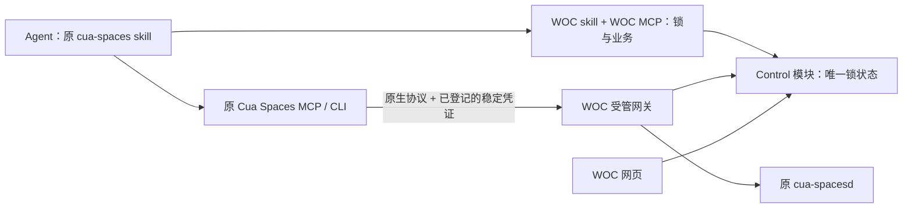

# 第二块 v3：原生 Cua 兼容与网关控制锁

2026-10-29，方案基线 `df229fe`。**用户已批准并完成控制锁基础设施与原生 Cua 兼容接入**，见 [接入验收](Cua-原生兼容与写锁验收.md)。本文第 5–7 节的消息、监控和日常操作仍是待讨论设计，没有启用消息监听、数据库读取或自动回复。

本项目三块固定为：① 新增完整桌面模式；② 消息读取、监控和人机协作；③ WOC 网页中的 AI 对话和日常操作。第一块已统一到 36083，功能交付、过夜观察另行收尾。本文是第二块，不将第三块的 UI/runtime 当作前置依赖。

## 1. 本轮调整

- 每台机器只有一个受管写锁；所有获准观察者可并发读。不引入单独“监控锁”“消息锁”或 MCP 自己的第二把锁。
- 保留 WOC 网页交互及 KasmVNC 传输，网页与新增 MCP 共享现有 ControlLeases。保留原版网页体验不等于让网页输入绕过锁。
- 保留原 Cua Spaces MCP、CLI 和技能的桌面操作接口，不修改原 Cua 代码；WOC MCP/skill 补充查询锁、上锁、解锁、消息与业务能力。它们汇入同一个服务端 Control 模块。后台任务直接调用共享实现，不必绕一次 MCP 网络。
- Cua 继续承担远端截图、辅助功能树、键鼠和窗口操作；MCP 是入口，既不替换 Cua，也不重新实现远程桌面。
- Cua Spaces 原生 App 直连按用户要求保留为不参与互斥的兼容入口。远端 coding agent、进程/命令执行本版也不纳入桌面锁，保留其原生逻辑，不因这些调用改变或释放锁。单写者保证仅覆盖明确受管的直接 GUI 输入，不覆盖例外路径产生的输入。
- 删除此前 OFF/BASELINE/HUMAN/RECONCILING/EXECUTING 等大型监控状态机。锁、监控开关、消息覆盖进度分别记录。
- 数据库探测移到 [独立研究](Cua-数据库读取独立研究.md)，不属于第二块。将来只接已经获准、验证过的读取能力，不预先实现空壳 DB adapter。

## 2. 当前 Cua 原理与已实现控制

### 两条画面/操作链路

WOC 网页：浏览器 → WOC 反向代理 → KasmVNC → 容器的 X 桌面。Agent：skill/CLI → 受管 Cua 网关 → 容器内 cua-spacesd → Cua Driver/辅助功能与系统输入 → 同一个 X 桌面。两路共享的是远端桌面，不要求 Agent 从网页里识别 canvas。Agent 操作时其他人可看同一个桌面的变化。

Skill 是给 Agent 的用法说明，不是传输协议，也不自动提供锁。Cua CLI、SDK、官方 MCP 是不同客户端入口；我们目前测试的是 CLI 0.7.0、spacesd 0.6.0，受管链路实际使用 HTTP/1 gRPC-Web。官方当前文档也描述 spacesd 的 gRPC/gRPC-Web 与 `/mcp`，已对部署版本的 63 个 Driver 工具分类并完成客户端 Agent 真实验收；平台本身的能力限制见验收记录，不承诺未知未来工具自动兼容。[Cua 协议](https://cua.ai/docs/cua-sdk/reference/protocol)、[Spaces 入口](https://cua.ai/docs/spaces)

### 当前权限（控制基础已部署）

| 入口 | 当前行为 |
| --- | --- |
| WOC 网页 | 登录与实例访问校验；默认只读；申请/交回控制；人工可接管 Agent；输入条和 VNC 写权限受同一租约约束 |
| 受管 Agent CLI | 使用可信服务凭证申请短期写租约，再用官方 Cua CLI 调受管网关；30 秒 TTL，执行中每 5 秒续租；过期不能写 |
| Master 自动登记 | 原三个登记使用稳定客户端凭证，WOC MCP 为同一身份上锁后可用原 Cua 写；旧服务身份的只读快照仍兼容 |
| 网关 | GUI RPC 与 `/mcp` 写调用检查客户端锁；63 个 Driver 工具有明确分类；进程/文件等原生调用按例外透传且不影响锁；受管媒体强制只读；未知 GUI 工具拒绝 |
| Cua Spaces 原生 App | P5 独立直连通道，绕过受管网关，按本轮要求继续保留；与受管操作同时使用仍可能冲突 |

现有持有者由 `human/agent + actorId` 表示；epoch 是某次控制权的版本，generation 是实例重建版本。交接先失效旧 epoch，再撤销网页写权限、断开旧可写连接、排空在途动作，最后授予新持有者。RPC 结果未知会阻止继续输入；租约不能撤销已经发出的消息。

源码：[leases](../../panel/server/src/control/leases.ts)、[runtime](../../panel/server/src/control/runtime.ts)、[读写白名单](../../panel/server/src/control/protocol.ts)、[gateway](../../panel/server/src/control/gateway.ts)、[受管 CLI](../../integrations/cua-agent/README.md)。现有服务凭证可申请全体受管实例，不是已经完成的按 Agent/任务授权系统。

## 3. 简化后的控制模型

一个机器级 Control 模块负责唯一写锁。对外只暴露三个状态：

| 状态 | 含义 |
| --- | --- |
| `free` | 可以申请写控制 |
| `held` | 某个人工页面或 Agent 任务持有写控制 |
| `blocked` | 正在交接、维护或等待故障恢复；`reason` 解释原因 |

`human/agent` 是持有者属性，不再扩展出不同业务状态。底层现有 handover/faulted/maintenance 的处理可保留，映射为 blocked；简化外部 Interface，不为改名而重写已验收的控制引擎。

必要记录：`machineId, state, ownerClientId, lockId, epoch, generation, lastWriteAt, idleExpiresAt, inflight, reason`。锁状态仅存于服务端，客户端不需要把 lockId/epoch 放进原 Cua 写请求。身份来自已验证的稳定网关凭证，不信任请求里任填的 clientId。lockId 仅供 WOC 解锁时防止迟到请求释放新一轮锁，底层版本与在途隔离由网关维护。身份粒度和稳定凭证的限制见第 4 节。

规则：

1. 读不申请写锁，读不阻塞写；仍检查读权限、范围与资源限额。可以观察另一个 Agent 操作；不是无权限公开桌面。
2. 写锁覆盖一段连贯的操作，例如“打开聊天 → 核对对象 → 输入 → 发送 → 核验”，不能每个点击都释放后重新抢锁。同一持有者的并发写也串行；首版沿用当前“存在在途写则返回忙”，不引入隐式队列。
3. Agent 遇到 held 返回 `CONTROL_BUSY`，不抢其他 Agent 或人工。后台扫描短时尝试，忙则推迟。人工通过网页明确接管；不能在旧动作尚未排空时声称已接管成功。
4. 锁采用空闲超时，首版不要求客户端心跳或 renew。建议初始值 120 秒，可配置；从上锁或最近一次获准的 GUI 写活动计算。普通读、监控轮询、锁状态查询、远端 Agent/命令调用不续期。活动写在途时不把锁交给别人；超时先禁止新写，再排空或进入待恢复。等待用户批准/长时间思考时主动释放；下次需重新上锁并观察。
5. 过期、接管、重启、重建均使旧租约失效；续租/写请求每次校验。网页的纯旁观连接不能改变远端分辨率、剪贴板、焦点；应用模式的 resize=remote 和无感剪贴板需要在第二块实测并约束，不能把它们误归类为“看”。
6. 维护/实例不可用时读取可以报不可用或返回明确标注时间的缓存，不能因为“读不锁”承诺任何时刻都能读取。

**已修正**：受管 Cua 网关与新 WOC 查询不会因读请求初始化/重置 driver。首次显式上锁准备控制；获准写入前复核运行实例，异步复核后再验证捕获的 epoch，避免容器变化后沿用旧锁。

读写并行不提供一致性快照：截图与树可能来自两个时刻，另一个 Agent 可能正在切换会话。每次观察附采集时间、账号/会话识别、epoch/generation、覆盖范围；跨变化的数据标记不确定，重采或在已持有的写租约内核验。即使同一 epoch，也不代表画面未变化。只读观察不自动升级为回复依据。

## 4. 最小侵入：稳定身份、服务端锁、原生错误提示



### 客户端不改代码，但需要一次身份配置

原生 Cua direct 连接携带登记的 bearer token。可为每个受管客户端签发稳定网关凭证，经原 `add_space`/登记流程保存；网关将其映射为 clientId 和可访问机器范围，再转换为远端原始 env token。后者只由服务端保管。Cua 调用自动携带已有凭证，获取锁后不换 token，不新增每次请求参数。

WOC MCP 的认证凭证也映射到同一个 clientId（可使用独立服务凭证），因此它为该身份申请的锁会直接作用于原 Cua 的后续写请求。不接受模型通过 `clientId=别人` 代领锁。`clientId` 只是服务端标识，稳定凭证才是身份依据。

**不能假定原始 Cua 的会话 ID 就是唯一客户端身份。** 官方 direct 协议明确 bearer 鉴权；本机协议观察中握手带 bearer，未见独立客户端身份头。部分原生接口有 session/action 标识或 relay principal，不代表每个请求都携带可验证、能跨 WOC MCP 对齐的 Agent 身份。[Cua 协议](https://cua.ai/docs/cua-sdk/reference/protocol)、[登记与凭证](https://cua.ai/docs/spaces/reference/spaces)

多个 Agent 共用同一 Cua daemon/登记凭证时，网关只能把它们当成一个客户端；不能宣称已实现这几个 Agent 之间互斥。首版可明确采用“一个 Cua 配置身份 = 一个操作者，同身份串行任务”。需要多 Agent 并发隔离时，通过各自受支持的独立配置/运行环境和独立稳定凭证实现，不修改 Cua 源码；具体配置隔离方式仍要验证。单靠多写一个 skill 无法凭空区分相同凭证的请求，不使用 IP、User-Agent 或 TCP 连接作为身份。

此路线保留工具名称和 schema，不承诺零配置。当前 Master 已切换为稳定客户端凭证；旧观察凭证和短期写 token 仅保留兼容入口，不作为新客户端身份方案。

### 原生错误成为操作引导

网关对已认证的受管 GUI 写请求执行：无锁/过期/他人持锁 → 在转发前拒绝；本客户端持锁 → 捕获当前内部 epoch，执行一次原调用并记录结果。只读不检查写锁所有者，也不触发锁初始化或恢复。

拒绝结果携带稳定错误码和可执行的提示，例如：

```text
WOC_LOCK_REQUIRED: 本次点击未执行。
请调用 woc_lock_acquire(machine_id="...")；成功后重新观察，再继续操作。
任务结束调用 woc_lock_release。连续 120 秒无 GUI 写操作会自动释放。
```

区分 `WOC_LOCK_REQUIRED / WOC_LOCK_EXPIRED / WOC_LOCK_BUSY / WOC_CONTROL_BLOCKED`。只对转发前拒绝的请求声明“未执行”；已转发但结果未知返回 `WOC_ACTION_UNCERTAIN`，要求核验，不提示重新发送。

按原协议返回错误：原生 gRPC status/message，gRPC-Web 合法 trailer，远端 MCP 调用使用兼容的 tool error (`isError` 与文本)。不用 HTTP 普通文本 403 代替所有协议错误，防止客户端丢失提示。HTTP MCP initialize/发现与读工具不能因为无写锁被挡住；嵌套 call_tool 必须根据实际内层工具和参数分类，不能一律按包装器名字算写。

已完成三轮真实客户端 Agent 验收：读取独立 WOC skill 和原 cua-spaces skill，通过原 Cua MCP 观察、看到无锁错误、WOC 上锁、原 Cua 操作、释放并再次被拒。最终复验使用原 Master 登记的 `woc-p3-dfde788ec9`，不是模拟 HTTP。两客户端争锁、实际 120 秒空闲超时、人工接管和媒体输入拒绝另有实测记录。

WOC skill 首先可独立提供全部锁规则。可选给本地 cua-spaces skill 增加一句：

> 操作 WOC 受管机器前用 WOC 工具取得写锁；空闲超时后需重新获取，用完释放。只读无需上锁；遇到 WOC 锁错误按提示处理。

Skill 是使用习惯，服务端校验才是执行依据。错误提示不自动加载客户端没有安装的 skill，接入时仍需配置 WOC 工具和 skill。

### 空闲超时与交接

只跟踪获准 GUI 写活动；首次 acquire 设置空闲期限，后续写到达时先检查是否已过期，再延长有效锁。不能先更新活动时间把过期锁自动复活。成功完成的在途写可从完成时重新计算期限；结果未知按已有隔离恢复处理，不直接解锁。轮询截图/Health/锁状态不续期；同一个持有者的重复 acquire 不应成为后台无限保活机制。

人工显式接管优先；先失效旧权限、排空动作/释放按键再交接。网关重启后锁不恢复，原客户端重新申请即可，稳定凭证不需要改变。release 验证调用者身份，建议再带 acquire 返回的 lockId，拒绝旧一轮的迟到释放；普通 Cua 调用不需知道 lockId。

没有每请求租约版本时，服务端无法识别“同一稳定身份释放后又上锁，随后才到达的旧任务请求”。因此首版承诺客户端级互斥、同身份串行、不自动重放；如果将来要求同一客户端多任务强隔离，需要独立身份或额外请求上下文，不能隐瞒这个限制。

### 本版锁范围

| 调用 | 写锁处理 |
| --- | --- |
| 截图、树、窗口列表、能力发现、消息缓存查询 | 免写锁，不刷新写活动时间；正常认证/访问范围仍保留 |
| 点击、键盘、滚动、拖动、鼠标移动、剪贴板写、激活/移动/缩放/关闭窗口、GUI 打开应用 | 受管 GUI 写，需要本客户端持锁 |
| 原生远端 Agent 的启动/查询/消息/停止，进程命令执行 | 本版保持原语义，免桌面锁，不替它申请、续期或释放桌面锁 |
| 原生 App 直连 | 保留此前例外 |
| WOC 重启/恢复等运维 | 沿用已有明确维护流程，不当作普通读，也不向日常锁工具扩大范围 |

远端 Agent/命令可能通过本地工具间接影响桌面，本版明确不仲裁；不能因此宣称“任何来源始终单写”。不解析 shell 文本猜它是否会输入。未知的新 GUI 工具需补分类后兼容，不能把未知项当只读；其他已知原生功能通过对应兼容路径转发，不能简单删除当前白名单就开放所有路径。

已恢复 `/mcp`、原生进程/文件流式传输等兼容路径，保留原客户端和远端 Agent 逻辑。实际验收了 agent_list、命令和文件往返；没有为了验收启动远端模型任务，因此不将 agent_start/message/stop 的实际模型运行效果声称为已测。视频和 viewer ticket 在受管网关强制只读，防止媒体侧 InteractiveInput/Action 绕过 GUI 锁；原生 App 独立直连仍不纳入。

## 5. 消息接口：隐藏技术细节，显式表达副作用

不按实现暴露 `read_ui_messages` 与 `read_db_messages` 给日常调用方；按行为分两类：

- **查询已有观察结果**：不操作桌面，不取写锁；可能不完整或过时，明确返回覆盖范围。
- **主动刷新指定会话**：可能切换窗口、打开聊天、滚动并改变已读状态；必须有相应授权和写锁。

不要用 `messages_read(mode=auto)` 在 UI/DB 之间偷偷切换，导致同名工具有时纯读、有时操作电脑。MCP 的 readOnlyHint 应与真实行为一致，并且只是提示，锁与权限仍由服务端实施。[MCP Tools](https://modelcontextprotocol.io/specification/2025-06-18/server/tools)

建议最小 Interface（工具名暂定）：

| 工具 | 作用 | 机器写锁 |
| --- | --- | --- |
| `machines_list` | 可访问实例、模式、能力与运行状态 | 否 |
| `woc_lock_status` | 读取 free/held/blocked 与控制者、空闲期限 | 否 |
| `woc_lock_acquire / woc_lock_release` | 按认证客户端身份上锁/解锁；空闲超时服务端负责 | 管理唯一写锁 |
| 原 Cua 观察工具 | 沿用 screenshot/tree/windows 等工具，不强制新封装 | 否 |
| 原 Cua GUI 操作工具 | 原调用方式；网关检查稳定客户端身份是否持锁 | 必须持有 |
| `messages_query` | 查询已采集消息，按聊天/时间/游标筛选 | 否 |
| `messages_refresh` | 明确主动扫描指定聊天及有限历史 | 必须持有；可由获准任务执行器短时申请 |
| `monitor_configure / monitor_status` | 配置监控范围/频率/主动扫描策略，查询覆盖情况 | 配置本身不取机器锁；后台主动扫描时取锁 |
| `events_read` | 按游标读取持久化事件，便于重连补读 | 否 |

WOC 新工具使用明确 schema。上锁只传目标机器和可选用途；身份从认证连接确定。解锁可携带 lockId 防迟到释放。客户端原 Cua 调用继续携带其已登记的稳定网关凭证，无新增锁参数。机器原始 token 不进入模型。

第三块复用这些接口，并增添 `chat_open / message_draft / message_send` 等有业务语义的 workflow，而不是每个按钮另造点击脚本。这些工具具体审批/参数可第三块细化；第二块先定义发送结果未知、会话歧义、草稿冲突等公共结果，避免后续重写。

读取结果最少包含：`accountRef, chatRef, items, cursor, observedAt, source, coverage, gaps`。items 区分有证据的应用 message ID 与我们生成的 observation ID，不能把文本 hash 当真实消息 ID。chatRef 是内部有作用域的引用，不承诺 UI 总能提供稳定账号/会话 ID；身份无法核实时返回歧义。

`cursor` 是我们本地事件记录的进度，不是假定的微信全量序号。`source` 当前仅 UI，未来可有获准的 DB 来源；调用方通常不关心路径/密钥，但必须知道结果时效、范围和来源。后台新消息通知通过持久化事件记录提供；MCP 客户端可轮询 events_read，通知只作唤醒提示，不依赖长连接通知保证不漏消息。

消息查询缺数据返回 partial/gap，不隐式申请控制、打开聊天或触发数据库探测。DB 若以后可用，只接明确获准的只读副本/读取模块；初始化探测单独授权，查询不会自动重新扫描进程内存。

## 6. 监控：一个开关与覆盖进度，复用写锁

每个监控配置只保存 enabled、目标账号/会话、频率、保留策略、是否允许主动导航。进度按会话保存 `cursor/lastObservedAt/lastAnchor/gaps`。blocked reason、目标离线、草稿冲突等作为本次结果，不再另造 HUMAN/EXECUTING 等状态。

- **被动观察**：无论人工、Agent A 是否持锁，其他获准观察者均可截图/读树。屏幕变化先去抖、识别当前聊天与消息区域；不把时钟变化、草稿或输入中的文字当新消息。默认继续观察选定微信范围，可选择人工期间暂停并记录 gap。
- **主动扫描**：仅在配置明确允许时，按有限时间片申请机器写锁；忙则推迟，不抢锁。处理需要导航的聊天、核对上下文、读取后释放。同一个任务内调用不会再申请第二把锁。
- **网页关闭**：监控运行在后端，不依赖浏览器标签页存活；界面仅显示配置和结果。
- **他人操作时**：观察到的中间画面仍可展示，但消息线索必须核验。非持有者不能同时点击另一个聊天来完成“读取”。读取可能看不到被遮挡窗口、未展开历史与虚拟化列表，不能承诺全量归档。

最简工作过程：

1. Agent A 持锁回复，人工及监控继续看；监控不能切换聊天。
2. 人工点接管，旧写会话立即失效，在途动作排空后人工获得控制。A 的待发计划失效，观察者继续记录可见变化。
3. 人工交回，机器 free。需要回补的扫描任务申请短写租约，重新识别账号/聊天，保留用户草稿，与最后已确认的几条消息重叠对齐。
4. 对齐成功更新覆盖进度；找不到锚点、重复文本无法区分或超出回看范围，保留 gap，返回 `NEEDS_REVIEW`，不能宣称全部同步。交回控制不自动重新执行中断的发送。

不额外增加“监控正在对齐所以锁住所有读取”的规则。对齐只是持有同一写锁的一次有限操作，其他人照样看。

## 7. 必须保留的业务事实

简化状态不意味着省略结果记录：

- 消息观测和事件先持久化，再推进游标；重复文本使用相邻序列等证据判断，歧义保留，不粗暴 hash 去重。
- 首次扫描/历史回补与实时新增分别标记，历史记录默认不触发回复。
- 写锁只解决受管直接 GUI 输入冲突，不覆盖本版豁免的远端 Agent、命令、原生 App，以及同账号手机端发消息、撤回或远端变化。回复前仍需重新核对会话、触发消息和当前草稿。
- 发送保留 operationId 与 `pending / verified / uncertain / cancelled` 结果；RPC 成功不等于对方收到。超时或接管发生在发送附近时不能自动重发。第三块扩展审批流程时沿用此契约。
- 读不加锁不等于自动获得上传截图/聊天到模型 API 的权限；模型供应商和允许的数据范围在第三块配置时明确。
- 原生 Cua App 不参与锁，系统无法可靠据此得知“人工刚接管”。使用该直连时，当前单写保证不覆盖它；必要时用户手动暂停自动任务。首版不强制改造这条兼容路径。

## 8. 第二块实施切片（M0/M1 已完成，M2/M3 待讨论）

| 阶段 | 交付与验证 |
| --- | --- |
| M0 原生兼容验证 | 两个独立客户端稳定凭证映射、WOC MCP 身份对齐；原 Cua MCP 无锁写提示可见、读可用、上锁后原调用成功、空闲超时和人工接管拒绝；无需修改 Cua 代码 |
| M1 服务端控制 | 三态投影、身份到锁映射、读不触发初始化、空闲计时与在途保护、原网页互斥；MCP/必要进程接口保留原语义，远端 Agent 不操作锁；列明已验收原生能力范围 |
| M2 消息观察 | messages_query、被动采样与持久化事件、覆盖与去重；先合成测试，再选择一个测试会话影子观察；无自动回复 |
| M3 主动刷新与对齐 | messages_refresh、有限时间片、草稿保护、人工交回重采；找不到锚点明确缺口；复用同一机器锁 |

第三块接入 WOC skill/MCP 和原 Cua 工具，补日常 workflow、网页 AI 会话、取消/恢复和发送策略。数据库独立研究；远端 Agent 锁定、同一 Cua 身份多任务隔离列为遗留，不阻塞首版。

建议默认：客户端级稳定身份；人工优先、Agent 不抢锁；120 秒无 GUI 写活动自动释放；查询与主动刷新分离。具体闲置时长可配置。网关与锁基础已部署；消息接口、真实监控、主动刷新尚未实施。
