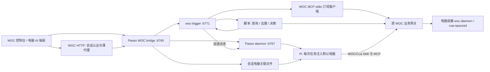

# Agent 会话关联电脑与通用自动化

## 职责与入口

沿用一个 WOC 控制台、一个独立无桌面的 `woc-agent` 容器、一个工作区 `/workspace/woc`。Paseo 负责会话、模型、历史、文件与 Agent 生命周期。WOC 页面增加电脑侧栏 AI 抽屉与自动化入口，复用精简 Paseo Web，不另写聊天服务。

`woc-trigger` 是独立后台进程和 HTTP 服务，不是新的 MCP server，也不放在每台微信容器里。它作为 MCP client 订阅已有 WOC MCP；WOC MCP 仍通过原网关访问容器 daemon。通知只意味着“值得检查”，脚本查询最近消息并维护去重状态。没有改变原 Cua 按端口路由、身份、写锁、人工接管规则，也没有新增反向获锁流程。

## 会话关联

关联是“默认任务目标”，不是访问权限或锁。一个会话关联零或一台电脑，仍可按用户明确要求访问其他电脑。

- Paseo fork `woc/runtime/associations.mjs` 提供 `/woc-api/machines`、`/woc-api/associations`、`GET/PUT /woc-api/associations/:agentId`，受 bridge 的 WOC 管理员会话认证保护。
- 状态 `/state/agent-associations.json` 按 Agent ID 原子保存，0600，最多 5000 条；机器由授权列表解析，不能仅凭客户端名称指定目标。执行中/初始化中拒绝更换，闲置/关闭/错误状态可更换。
- `woc-agent` 启动 hook 将 `WOC_AGENT_ID`、`WOC_ASSOCIATIONS_FILE` 传给 Pi；`target-extension.ts` 在 **每次 `before_agent_start`** 读取当前关联、追加到本次 system prompt。同时附带 `display:false` 的当次扩展上下文，避免当前模型链路沿用历史目标。实测仅更新 system prompt 时，最终请求已有新目标但回复仍为旧目标；尚未进一步区分是上游会话复用还是模型行为。不修改用户原文、聊天界面不显示重复提示，也不在每个工具调用时重新读取目标。隐藏上下文保存在底层会话记录中。
- 目标更新在下一次任务生效；既有运行任务不会中途被改目标。关联提示要求先查询状态，名称仅标签，GUI 写入仍显式获锁。当前只配置 Pi，接入其他 provider 时须实现其等价任务上下文机制。
- 已删除电脑会由原网关返回不可用，Agent 不得自动改用同名电脑。共有工作区是可信共享环境，不是各 Agent 的 OS 隔离边界。

UI：会话顶部可选默认电脑；电脑页点 AI 助手，优先打开最近关联会话，没有就输入任务创建。展开到完整 AI 页携带同一个 Agent ID。桌面窄屏抽屉覆盖显示、可关闭；宽屏并排，不重建或改写远端桌面。手机会话顶部同样显示关联目标。

## 自动化

WOC `/automation` 管理触发器，支持间隔、每日时间/Cron（含时区）、MCP 资源更新、Webhook。动作是脚本或投递给已有 Agent 会话。界面统一通过“新建”入口配置；弹窗内可选“微信消息检查”预置模板，选择电脑、会话/联系人/群、目标 Agent 和任务文字后，套用为普通 MCP 资源更新 + 脚本动作。模板不创建独立任务类型，生成后可继续修改通用配置，默认停用；首次执行只建基线。既有自动化直接用通用表单编辑，保留脚本参数。

执行、队列与状态属于 `services/woc-trigger`，面板 `integrations/automation.ts` 只代理。Agent 可通过 `integrations/skills/woc-automation/SKILL.md` 和 CLI 管理同一套配置。脚本也可调用 `agent send`；这不是新增权限，GUI 写入仍在后续 Agent/Skill 处经过原网关锁检查。

API、状态、队列、幂等保留窗口与容量边界见 [服务 README](../../services/woc-trigger/README.md)。`unknown/interrupted` 不自动重试。记录“已接收/已回复且空闲”与实际业务任务成功是不同事实，页面的运行记录链接原 Agent 会话方便核对。

## 部署与回退

1. Agent 容器保持现有固定镜像。挂载 `services/woc-trigger` 到 `/opt/woc/services/woc-trigger`，在 Linux Node >=22.13 下按 lockfile `npm ci --omit=dev --ignore-scripts`；同步 skill 到 `/opt/skills/woc-automation`。
2. 运行 `node /opt/woc/services/woc-trigger/src/configure.mjs`，使用既有受信配置入口注册独立自动化服务身份，生成私有 `/state/automation/` 配置。密钥不进 Git、不输出日志、不和 GUI 会话凭证混用。
3. 同步 Paseo fork `woc/`、Web 静态产物，使用 `woc/deploy/compose.yaml` 声明的 `WOC_TRIGGER_CONFIG`、`WOC_TRIGGER_TOKEN_FILE`、`WOC_ASSOCIATIONS_FILE` 环境变量。`start.mjs` 管理独立 trigger 子进程，退出后 3 秒重启。
4. 仅更新统一 panel 镜像；不重启微信/浏览器/桌面/Cua worker。部署前确认 Agent 无在途任务，备份 compose、运行时源码、模型设置、Web index、面板旧镜像引用与源版本记录。静态资源先上传哈希文件，最后原子切换 index，保留上一版引用资源。
5. 回退：停用自动化，Agent 无在途任务后恢复备份 compose/runtime/settings/index 并重建仅 Agent 服务；panel `.env` 还原固定 image ID，仅重建 panel。保留 `/state/automation` 与关联文件供诊断，旧版忽略它们。备份点位于部署机 `/root/woc-agent/rollback/20261030-association-trigger/`，其中包含私有配置，不上传。

原有 Agent 模型、独立电脑注册、原 Cua skill/MCP 代码保持原逻辑。新增 API 是 WOC 自定义能力；不改 Paseo schedule。

## 验收记录（2026-10-30）

已验证：本地类型检查与 lint；关联持久化/忙时拒绝/Pi 每次任务重读；HTTP 权限隔离；真实 stdio MCP 通知突发合并、断线重连、停用；队列重启不重放未知执行；脚本超时；微信样例首次基线、去重、出站过滤、pending 恢复。

部署后已验证：电脑页抽屉、展开保留会话、首次新建关联会话；真实 DeepSeek 系统目标注入；真实 Agent 任务及匹配回复记录；真实 Webhook 独立认证、输入不作为 shell；间隔执行与停用；Cron 时区；真实 Agent 阅读自动化 Skill、经 CLI 创建停用任务、手动运行、核对日志、删除任务。

真实微信测试消息触发 `resource_updated → 查询去重 → Agent 投递 → 回复`，脚本识别 1 条新消息、投递 1 次；再次查询为 `new:0`，未发送任何微信回复。微信模板的最近会话/联系人搜索、手机布局及隐藏任务上下文均已验证。修复 system-only 连续会话目标更新不稳定后，同一真实模型会话切换电脑和取消关联均通过；隐藏上下文不显示在聊天界面。

最终重启验收：仅重启专用 Agent 容器后，关联电脑、停用状态、14 条执行记录均保留，运行队列为空，未重放任务。微信、浏览器、完整桌面、独立 Cua worker 的容器 ID 与启动时间逐一对比部署前快照完全一致。验收触发器已删除、两个新建测试会话已归档（历史保留），原有会话未改动，未开启常驻自动回复。

浏览器回归：远端 VNC 已连接时，打开/关闭 AI 抽屉保持同一个桌面 iframe；10 Mbps 限速测试，AI 页面冷启动约 4.9 秒，缓存后刷新约 0.44 秒。静态资源仍复用 Paseo Web 主包，本轮未拆分上游应用包。
