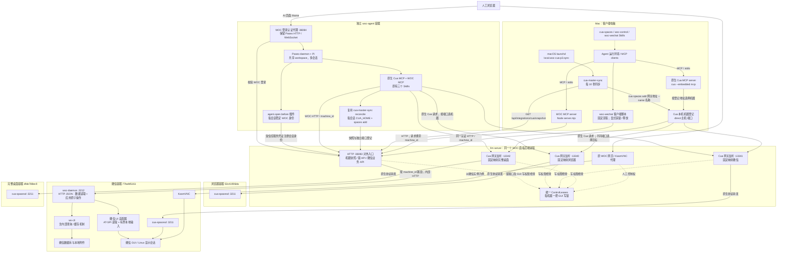

# WOC、Cua 与微信读取服务架构

记录日期：2026-10-30。本文描述当前实现，包含微信数据读取与应用 GUI 原子接口。新增或修改操作前必须阅读 [WOC 应用操作开发规则](WOC-应用操作开发规则.md)；本文维护拓扑和实现位置，开发规则维护职责边界。

## 1. MCP、Skill、daemon 分别是什么

- MCP Host 是运行 Agent、管理工具连接的程序；其中的 MCP client 负责连接工具提供者。
- MCP server 是提供工具的程序，可以运行在 Agent 同一台电脑，也可以运行在远端。“client/server”是协议角色，不是物理机器的位置。
- 当前 Mac 上有两个本地 MCP server：原生 `cua --embedded mcp` 和自定义 Node WOC MCP。它们通过 stdio 与 Agent 运行环境通信。
- 本地 MCP server 向远端发送 HTTP 或 Cua 原生请求时，又充当相应协议的客户端。远端不必再运行一个 MCP server。
- Skill 是 Agent 阅读的操作说明，不是常驻服务；调用由 Agent 通过工具或 Skill 附带脚本发出。
- daemon 只表示常驻程序。容器内 `woc-daemon` 是普通 HTTP JSON 服务；`cua-spacesd` 提供 Cua 原生服务，当前网关兼容 gRPC-Web 和 `/mcp` 入口。不能把所有 daemon 或网络接口都称作 MCP。

概念参考：[MCP 官方架构说明](https://modelcontextprotocol.io/docs/learn/architecture)。实际工具和传输以本仓库及部署版本为准。

## 2. 当前调用与登记拓扑

实线表示调用/登记，虚线表示操作说明或共享状态。三个网关监听器属于同一个面板后端进程，不是三个网关容器。



登记表节点表示地址解析，不是实际转发进程。Cua MCP 根据登记结果直接向对应网关端口发送请求。图中的浏览器、桌面容器未因此自动获得微信读取服务；读取服务需单独配置。

## 3. 为什么兼容 Cua 使用不同端口

当前直连 Cua 登记以地址区分机器，显示名称不参与网络分流。网关为每台受管机器分配独立入口，保留原生客户端协议和选择机器的方法。

| 用途 | Cua 直连登记 ID | 后端目标 |
| --- | --- | --- |
| WOC 浏览器 | `direct:192.168.31.101:13340` | `woc-wx-53c41906da:3211` |
| WOC 微信 | `direct:192.168.31.101:13341` | `woc-wx-77bafd5161:3211` |
| WOC 完整桌面 | `direct:192.168.31.101:13342` | `woc-wx-dfde788ec9:3211` |
| 独立原有机器 | `direct:192.168.31.101:13211` | 独立直连；不由上述 WOC 同步管理 |

同一个 Node 后端进程创建多个网络监听器；连接进入哪个端口，就选择哪个预先映射的目标。各容器内部都用 3211，因为网络地址不同，不冲突。网关重启会暂时影响所有受管连接，但不等于微信及桌面容器重启。

对同一地址再次 `spaces add` 会更新登记，不会因为改了名字而成为另一台机器。WOC 机器 ID、Cua 登记 ID、显示名称是三个概念，不能互换。

新 WOC 业务接口由我们定义，可以共用一个 HTTP 入口，以路径或请求体区分机器：

```text
POST :36083/api/integrations/wechat/77bafd5161/history
POST :36083/api/integrations/woc/acquire
     body: {"machine_id":"77bafd5161"}
```

面板后端按 machine_id 检查 ACL，并将读取请求路由到该机器的 `woc-daemon:3212`。这是业务 HTTP，不是另一套远端 WOC MCP。

## 4. 自动登记：cua-master-sync

同步程序运行在 Mac，当前由用户级 launchd 任务 `local.woc-cua-p3.sync` 管理；配置为 RunAtLoad、KeepAlive。私有配置位于 `~/.local/share/woc-cua-p3/config.json`，当前同步间隔为 10 秒。

1. 从 WOC 认证快照 API 获取实例名称、网关地址、就绪状态和连接凭证。
2. 通过原生 `cua spaces ls --json` 对比当前登记。
3. 对应登记通过 `cua spaces add <endpoint> --name <name>` 创建或更新。凭证经环境变量传入，不放进命令参数或文档。
4. 保存本程序负责的登记关系，并向面板确认同步结果。
5. 仅在明确删除记录且属于本程序管理范围时忘记登记；离线或快照暂时缺失不等于删除。

它不创建 Docker 容器，也不切换 Agent 当前桌面。停止它不会删除现有登记或停止容器；后续变化将不再自动同步。它不负责管理原来的独立机器。

Cua 原生列表也支持其他来源，包括原生创建流程和账号 relay 电脑。这里采用的是按地址登记并自动同步，不能理解为 Cua 扫描局域网发现了所有容器。当前独立 `cua-worker-01` 是 direct 登记；仅凭登记记录不能反推出当初是谁添加的。

## 5. 身份、锁与两条调用链

原生 Cua 与 WOC MCP 使用对应同一服务端客户端身份的稳定凭证。真实锁状态由面板的 ControlLeases 管理，Skill 只提供使用说明。

GUI 操作：

```text
Agent → WOC MCP / woc_lock_acquire → 面板锁管理
Agent → 原生 Cua MCP / 点击 → 对应端口网关 → cua-spacesd → GUI
Agent → WOC MCP / woc_lock_release → 面板锁管理
```

网关根据凭证识别调用者，检查其机器访问权限和 GUI 写锁，并替换为容器内部连接凭证再转发。客户端无需给每个原生 Cua 操作增加锁参数；原生 Cua MCP、Skill、spacesd 的代码未因写锁修改。

读操作不需要 GUI 写锁，不续期。稳定客户端锁默认 120 秒无 GUI 写操作后过期；人工网页按登录用户识别持有人，同用户多个页面共享控制权；向其他用户申请须当前持有人同意，强制接管其他用户仅限管理员；Agent 持锁时，网页用户看到具名确认提示，确认后才接管，取消不改变锁。确认绑定该次 Agent 控制周期，控制权变化后旧确认无效。持锁页每 5 秒心跳，默认停止心跳约 30 秒后过期；独立的人工无键鼠操作默认 5 分钟后交回，心跳不延长此期限。这三个时间可在管理 → 系统 → 控制权超时配置，管理员保存后对受管实例立即生效。刷新查询服务端状态，不重新申请；见 [当前申请机制](WOC-控制权申请与只读界面.md)。缺锁、超时、占用错误通过原生协议返回，提示 Agent 使用 WOC 工具处理。

微信数据查询：

```text
Agent → WOC MCP / woc_wechat_history
      → 面板 HTTP 业务 API（身份、机器 ACL）
      → 容器 woc-daemon → wx-cli → 数据库
```

查询不经过 cua-spacesd，不占 GUI 写锁。附件 extract 仅导出本地已有文件，返回有身份校验及有效期的下载入口；不触发 GUI 下载或联网取媒体。wx-cli 的解密密钥留在服务端私有路径，本文不记录任何密钥或 token。

共享一个客户端凭证意味着共享一个锁持有人；同身份任务仍需串行操作。该锁不是所有系统副作用的通用隔离边界：原生进程、远端 coding agent、文件接口保留原逻辑，不获取、续期或释放 GUI 锁；此前明确保留的 Cua Spaces App 直连也不参与锁仲裁。

## 6. 读取 daemon 与 MCP 通知

`woc-daemon` 与 `cua-spacesd` 位于同一个已配置容器，职责并行。前者调用白名单 wx-cli 命令读取数据和本地文件，并可显式启用微信 UI 适配器。读取不加 GUI 锁；UI 写入由网关检查同一把锁。daemon 不申请锁，不回调网关，也不自动扫描密钥。

WOC MCP 当前暴露机器列表、锁状态/申请/释放，以及微信 health、sessions、unread、contacts、groups、members、history、search、attachments、extract。

当前 MCP 适配器还提供 `wechat://MACHINE_ID/messages` 资源及订阅。在存在订阅时，它轮询远端 revision 变化并发出 MCP `notifications/resources/updated`；这是重新查询的提示，不是逐条消息推送。没有业务事件序号、离线补发或自动启动模型的保证。微信未读是会话级状态，不代表 Agent 已处理或未处理。

## 网页 AI 助手接入

AI 助手运行在独立的 `woc-agent` 容器，Paseo 管理会话、历史和 Pi 进程，WOC 仍管理机器和写锁。它是另一台客户端电脑，不替代应用容器里的 `cua-spacesd` / `woc-daemon`，也不替代 Mac 上的同步程序。当前只有管理员可访问共享 Agent 工作区，所有会话可使用全部 WOC 机器。

浏览器通过 WOC 的 AI 入口嵌入适配后的 Paseo Web。认证代理复用 WOC 登录，Paseo 的私有密码不发给浏览器。每个会话在打开/恢复时获得独立 WOC 身份和 `CUA_HOME`，Cua MCP 启动时复用既有 reconcile 登记机器，并定期刷新；锁仍由客户端 Skill 显式申请/释放。Agent 会话不是互相隔离的操作系统用户，workspace 文件共享。

简化界面、Paseo 插件、容器及认证代理均维护在独立 [paseo-fork 的 WOC 分支](https://github.com/muzhi1991/paseo-fork/tree/feat/woc-embedded)。本仓库只保留控制台入口及受信任身份注册接口。部署及完整设计见该 fork 的 `docs/woc-integration.md`；不要把 Agent 编排搬入 WOC 网关或应用 daemon。

## 7. 代码与部署位置

下列代码链接相对本文件所在目录。

| 部分 | 代码 / 说明 |
| --- | --- |
| AI 控制台入口 | [Agent.tsx](../../panel/web/src/pages/Agent.tsx) |
| 受信任 Agent 身份注册 | [agent.ts](../../panel/server/src/integrations/agent.ts) |
| 本机 WOC MCP，stdio | [server.mjs](../../integrations/woc-mcp/server.mjs) |
| WOC Skill，已链接到本机 Skill 目录 | [woc-control/SKILL.md](../../integrations/skills/woc-control/SKILL.md) |
| 本机机器同步程序 | [sync.mjs](../../integrations/cua-master-sync/sync.mjs) |
| Cua 网关与目标映射 | [gateway.ts](../../panel/server/src/control/gateway.ts)、[runtime.ts](../../panel/server/src/control/runtime.ts) |
| 唯一 GUI 锁实现 | [leases.ts](../../panel/server/src/control/leases.ts) |
| WOC 锁 HTTP API | [client-routes.ts](../../panel/server/src/control/client-routes.ts) |
| 微信业务 HTTP 路由与契约 | [routes.ts](../../panel/server/src/business/routes.ts)、[contract.mjs](../../panel/server/src/business/contract.mjs) |
| 微信 UI 契约与网关 | [ui-contract.mjs](../../panel/server/src/business/ui-contract.mjs)、[ui-routes.ts](../../panel/server/src/business/ui-routes.ts) |
| 微信 UI 适配与客户端编排 | [wechat_ui.py](../../services/woc-daemon/wechat_ui.py)、[ui_service.py](../../services/woc-daemon/ui_service.py)、[Skill 脚本](../../integrations/skills/woc-wechat/scripts/wechat.py) |
| 容器微信读取服务 | [server.py](../../services/woc-daemon/server.py) |
| 统一部署与读取服务安装 | [统一部署](../../deploy/unified/README.md)、[读取服务](../../deploy/read-daemon/README.md) |
| 读取能力验收 | [验收记录](WOC-read-daemon-acceptance.md) |

本机 MCP 配置为 `cua_native`（`cua --embedded mcp`）和 `woc`（Node server.mjs）。WOC 私有客户端配置位于 `~/.local/share/woc-client-v3/`，不提交仓库。容器读取服务内部端口为 3212，当前安装路径 `/config/woc-read/`，由容器 s6 管理。

## 8. 应用 GUI 接口与开发规范

应用操作的职责、锁规则、前置条件、错误语义和新增接口要求统一维护在 [WOC 应用操作开发规则](WOC-应用操作开发规则.md)，并由仓库根 [AGENTS.md](../../AGENTS.md) 要求开发前阅读。2026-10-30 用户确认的单向调用和客户端编排原则继续适用；此前的 daemon 回调取锁、网关自动补做 UI 步骤等早期建议不再适用。

当前实现：网关 `ControlLeases` 管理唯一 GUI 锁，HTTP/MCP 共用接口契约；daemon 执行应用专属短操作；客户端 Skill 脚本负责多步流程。原生 Cua 保留通用 computer-use 通道。具体新增操作如何分层，以开发规则中的判断表和案例为准。

网页输入机制的早期调研见 [微信 UI 原子操作调研](WOC-WeChat-UI-原子操作调研.md)。首版部署了 7 个 UI MCP/HTTP 接口和 [woc-wechat Skill](../../integrations/skills/woc-wechat/SKILL.md)，真实联系人、群聊、搜索和发送验证见 [首版验收](WOC-WeChat-UI-验收.md)。

`ui_state` 返回页面类型及该页面的 data；`navigate` 只切换已支持的页面，`ui_search` 要求当前范围匹配，`open_item` 只打开刚观察到的项。它们不会隐式寻找任意聊天。客户端脚本依据 wx-cli 的会话/联系人/群组结果解析目标：当前可见就打开，否则在会话页或联系人页搜索，不逐屏滚动。`fill_text` 和 `send_draft` 均核对当前聊天及草稿；客户端编排，daemon 每次执行一个短操作。

内置浏览器扩展增加 `browser_state`、`browser_open_url`，并为 `navigate` 增加 `web_search` 页面；客户端 `open-url` 脚本负责浏览器缺失时的启动及流程编排。实现位于 [wechat_browser.py](../../services/woc-daemon/wechat_browser.py)，真实链路验收见 [浏览器入口调研与实施](WOC-WeChat-内置浏览器入口调研.md)。这些短操作仍遵循同一分层规范。
